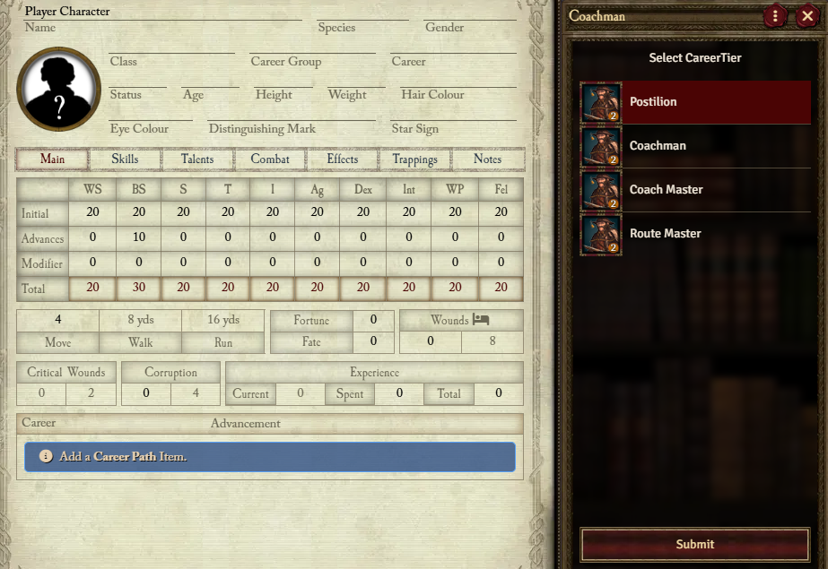
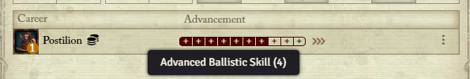
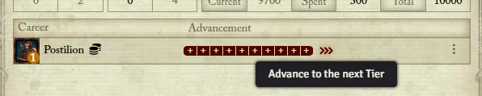
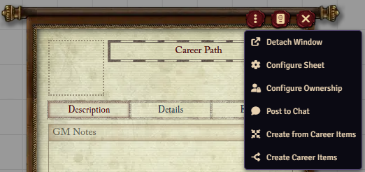

{: .important}
**This article is for 5h Edition Rules. For 4th Edition, see [Careers](./careers.md)**

Career Paths are the newer version of the Career Item which defines multiple tiers within a single item. When provided to an Actor, it tracks the advancement through each tier.

If you're coming from Career Items, there are several advantages to using Career Paths. Most notably, tracking changes to the career (like when specifying **Melee (Any)** or any other specialisation) is much simpler as it's all contained within a single Item. 

## Adding a Career Path

Like any Item, you can add a Career Path by dragging and dropping the Item from the World sidebar or the Compendium. If you do not have a Career Path already, or no current career, adding a path will prompt you to select a Tier, this will be the current tier used by the Actor. If a current career *does* already exist on an Actor, you will be prompted to spend XP for switching Careers. 

## Advancement

Each Characteristic advanced, Skill advanced, or Talent gained adds to the Advancement tracker for the current career tier. Once the tracker has been filled, the Career can be advanced into the next tier by clicking the Advance button.

### What about Trappings?

{: .question}
As defined by the rules, Trappings from the next tier also count for Advancement, however, this is not automated. You can designate these advances by clicking on an empty pip on the tracker which will prompt for an Advancement label to enter the Trapping name.

## Converting Career Paths

If you wish to convert existing Career Items to use as Career Paths, or vice versa, you can do so easily. This is done via the Career Path sheet's context menu.

### Converting Careers to Paths

Simply provide any Career Item (any tier), the converter will then find all the other Tiers. If more than 4 are found, it will prompt you to select what should be included. 

### Converting a Path to Careers

This will create a Career Item in the world for each Tier in the Path.